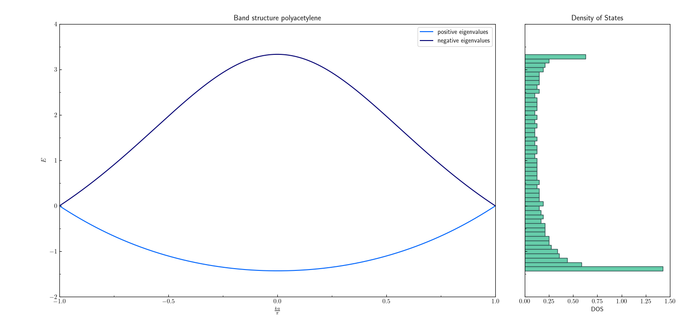
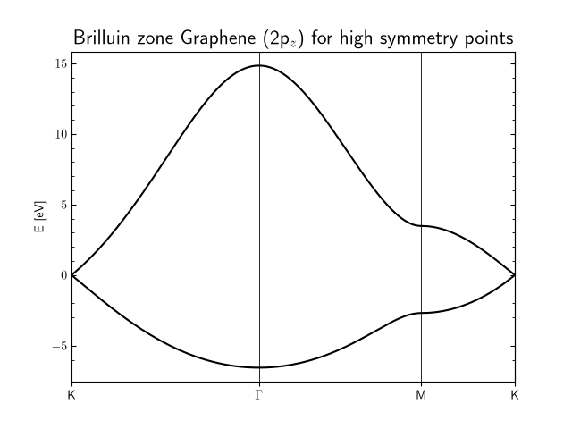
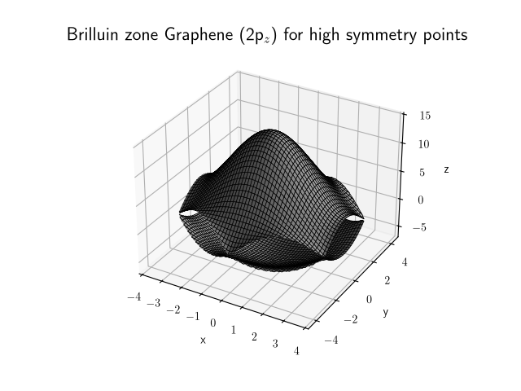
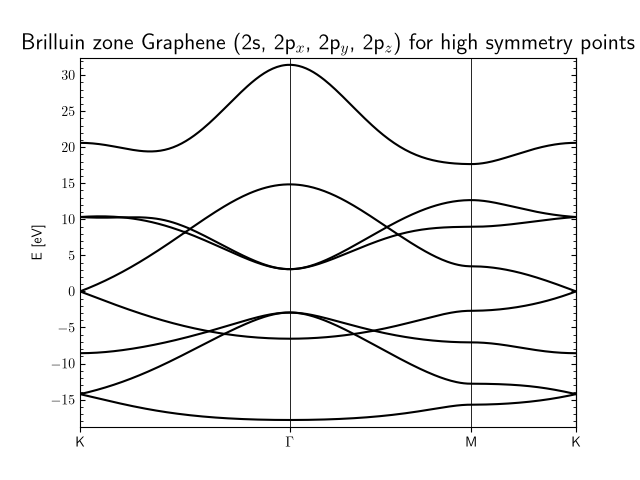

# Graphene Band Structure Using Tight-Binding Models
Simulating the band structure of graphene using the tight-binding method

## Project overview
Using the tight-binding method, we will calculate the band structure of graphene. 
Using the calculated eigenvalues, we will try to calculate the density of states (DOS) over the Brillouin zone.
Afterward, we will try to use this code to calculate the band structure and DOS for hexagonal Boron Nitride (h-BN)

## Current progress
- [x] tight-binding method implemented for 1D, PolyAcetylene
- [x] Solver and Plotter implemented for simplified graphene model (only 2p_z orbitals)
- [x] Solver and Plotter generalised
- [x] Model created for simulation of graphene (2S, 2p_x, 2p_y and 2p_z orbitals)
- [ ] DOS calculations based on the calculated eigenvalues
- [ ] expanding the model for h-BN

## Repository structure
| File                        | Description                                                                     |
|---|---|
| `TB_Saitobook.pdf` | reference document for tight-binding calculations on polyacetylene and graphene |
| `example_polyacetylene.py` | scripts for solving the band structure and DOS for polyacetylene |
| `graphene.py` | scripts for solving the band structure and DOS for graphene |
| `README.md` | description of the GitHub repository |

## Requirements
- Python 3.14
- NumPy
- SciPy
- Matplotlib
- Termcolor

## Current results
The eigenvalues of the current graphene model, Solver and Plotter reproduce the same graphs as seen in reference document `TB_Saitobook.pdf`
### PolyAcetylene

### Graphene, only 2p_z

### Graphene, full model

## Authors
Dylan Assinner & Ella Bernaerts

Bachelor fysica, UAntwerpen
